<a href="https://www.m1d0.com"><picture><source media="(max-width: 640px)" srcset="./assets/banner-mobile.svg" /></picture></a>

<a href="https://github.com/M1D0-Technologies/dahhan-enterprises">Dahhan Enterprises</a> · <a href="https://github.com/M1D0-Technologies/dahhan-industries">Dahhan Industries</a> · <a href="https://github.com/M1D0-Technologies/miss-dantella">Miss Dantella</a> · <a href="https://github.com/M1D0-Technologies/m1d0-technologies">M1D0 Technologies</a> · <b>Platform Engineering</b> · <a href="https://github.com/M1D0-Technologies">Organization</a>

# Platform Engineering & Automation

How **M1D0 Technologies** builds and runs the systems that support the businesses it leads. M1D0 leads the transformation and long-term development of Dahhan Industries and Miss Dantella—across operations, commerce and supporting systems. Technology follows the direction the business sets; this is the engineering standard behind it.

This is a capability overview, not a codebase. It describes how the work is done without exposing source code, systems, providers or operational detail.

## Engineering philosophy

<picture><source media="(prefers-color-scheme: dark) and (max-width: 640px)" srcset="./assets/principles-mobile-dark.svg" /><source media="(max-width: 640px)" srcset="./assets/principles-mobile-light.svg" /><source media="(prefers-color-scheme: dark)" srcset="./assets/principles-dark.svg" /></picture>

Every environment-facing decision is written as code and reviewed before it takes effect. Production is dark until explicitly approved. Releases are immutable and versioned, and destructive or sensitive actions require deliberate human approval. The safe state is the default state, drift shows up in a diff, and every change is recoverable.

## Release engineering

<picture><source media="(prefers-color-scheme: dark) and (max-width: 640px)" srcset="./assets/release-mobile-dark.svg" /><source media="(max-width: 640px)" srcset="./assets/release-mobile-light.svg" /><source media="(prefers-color-scheme: dark)" srcset="./assets/release-dark.svg" /></picture>

## Capabilities

<picture><source media="(prefers-color-scheme: dark) and (max-width: 640px)" srcset="./assets/capabilities-mobile-dark.svg" /><source media="(max-width: 640px)" srcset="./assets/capabilities-mobile-light.svg" /><source media="(prefers-color-scheme: dark)" srcset="./assets/capabilities-dark.svg" /></picture>

## Links

<a href="https://www.m1d0.com"><picture><source media="(prefers-color-scheme: dark) and (max-width: 640px)" srcset="./assets/tiles/web-mob-dark.svg" /><source media="(max-width: 640px)" srcset="./assets/tiles/web-mob-light.svg" /><source media="(prefers-color-scheme: dark)" srcset="./assets/tiles/web-desk-dark.svg" /></picture></a><a href="https://www.linkedin.com/company/m1d0/"><picture><source media="(prefers-color-scheme: dark) and (max-width: 640px)" srcset="./assets/tiles/li-mob-dark.svg" /><source media="(max-width: 640px)" srcset="./assets/tiles/li-mob-light.svg" /><source media="(prefers-color-scheme: dark)" srcset="./assets/tiles/li-desk-dark.svg" /></picture></a>

Documentation and showcase material only; product source code is kept private. © 2026 Dahhan Enterprises LLC. All rights reserved.
